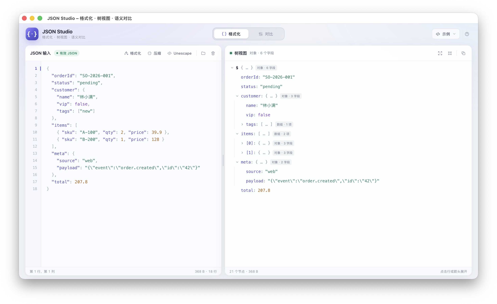
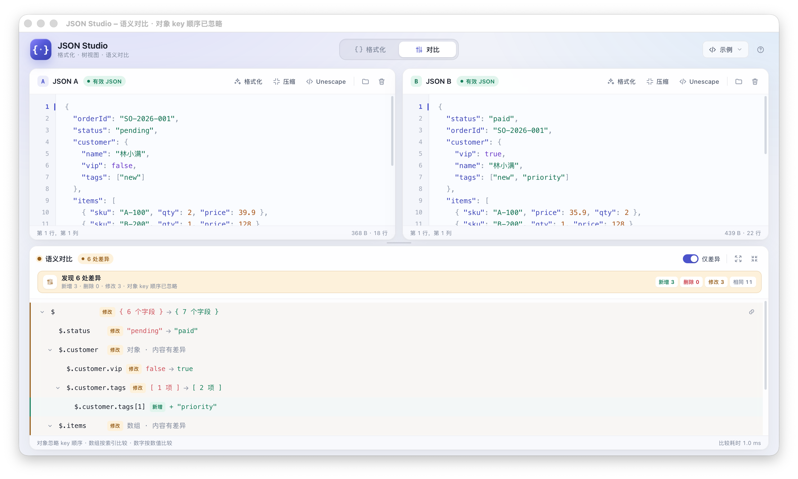

# JSON Studio

**A native macOS JSON workbench for formatting, exploring, unescaping, and semantically comparing JSON — completely offline.**

English | [简体中文](README.zh.md)

[](#requirements)
[](LICENSE)
[](#development)
[](tests/core.test.js)

JSON Studio is a small, dependency-free macOS app for people who work with JSON every day. It combines a syntax-highlighted editor, a collapsible tree view, a two-mode Unescape String tool, and a structural diff that **ignores object key order** at every nesting level. No data leaves your Mac.

| Format & tree view | Semantic compare |
| --- | --- |
|  |  |

## Highlights

- **Key-order-insensitive comparisons.** Compare two JSON documents at any depth. Reordered object keys produce no diff; real value changes are highlighted.
- **Readable trees.** Explore objects and arrays with syntax colors, type labels, expand/collapse controls, and copy actions for values and paths.
- **Format, minify, inspect.** Pretty-print with two-space indentation or compress to a single line while preserving key order and numeric spelling.
- **Unescape String.** Decode escaped JSON from logs and API payloads, or expand JSON documents embedded inside string values.
- **Native macOS experience.** Native window and menus, light/dark appearance, drag-and-drop, Finder integration, and remembered window size.
- **Offline by design.** No telemetry, no CDN, no runtime dependencies, and no network requests from the app.

## Quick start

### Requirements

- macOS 13 Ventura or later
- Universal binary: Apple Silicon and Intel
- To build locally: macOS Command Line Tools; Xcode is not required

### Download

1. Open the **Releases** page of this repository.
2. Download `JSONStudio-<version>-macOS.zip` and verify it against the adjacent `.sha256` file if you like.
3. Unzip it and drag `JSON Studio.app` into **Applications**.

The app is ad-hoc signed, not notarized. If Gatekeeper blocks the first launch, right-click the app and choose **Open**, or remove the quarantine flag:

```bash
xattr -dr com.apple.quarantine "/Applications/JSON Studio.app"
```

### Build from source

From a clone of this repository:

```bash
./build.sh
open "build/JSON Studio.app"
```

Create a distributable ZIP:

```bash
./make-release.sh
# dist/JSONStudio-1.0.0-macOS.zip
```

## Features

### Tree view and editor

- JSON syntax highlighting and line numbers
- Parse errors reported with line and column, plus an error-line marker in the gutter
- Expand/collapse individual nodes, or expand/collapse the whole tree
- Copy a node's JSON value or its JSON path from the row actions
- Import a JSON file with the toolbar, drag-and-drop, or Finder's **Open With**

### Formatting and compression

- **Format** with two-space indentation
- **Compress** to a single line
- Preserves the original object key order and number lexemes such as `1e3` or `0.50`
- Formatting and minifying are undoable with `⌘Z`

### Unescape String

Open the tool from either editor with `⌘⇧U`.

- **Unescape whole text** decodes `\"`, `\\`, `\n`, `\t`, `\uXXXX`, `\u{1F680}`, line continuations, and similar sequences. It handles globally escaped payloads copied from logs.
- **Parse nested JSON** walks string values and replaces JSON-looking strings with real objects or arrays. This is useful for webhook payloads, queue messages, and double-encoded API fields.
- Valid JSON documents are protected from accidental structural damage in whole-text mode.
- Preview the output before applying it to the editor; the edit is undoable.

### Semantic comparison

- Live comparison while you type
- Summary counts for **added**, **removed**, **changed**, and **same** values
- A toggle to show only differences, plus expand/collapse controls
- Type changes are called out explicitly
- Added or removed objects can be expanded to inspect their fields
- Paths and changed values are easy to read and copy
- A clear equality banner when the two documents match semantically

### Platform integration

- Native application menu with keyboard shortcuts
- `⌘O` opens a file into the active editor
- Finder document type for `.json` files
- System light and dark appearance
- Full-screen support and window-size persistence

## Comparison semantics

| Input | Result |
| --- | --- |
| `{"a":1,"b":2}` vs `{"b":2,"a":1}` | **Equal** — object key order is ignored at every depth |
| `[1,2]` vs `[2,1]` | **Different** — arrays are compared by index |
| `{"n":1}` vs `{"n":1.0}` | **Equal** — numbers are compared numerically |
| `"\u4e2d"` vs `"中"` | **Equal** — strings are compared by decoded value |
| Comments, trailing commas | **Invalid JSON** — rejected with a line/column error |
| Duplicate object keys | **Invalid JSON** — reported instead of silently keeping the last value |

Formatting, whitespace, and key order never affect the result. Added, removed, and changed values are counted as leaf changes; container rows are shown as context so you can expand into the details.

## Keyboard shortcuts

| Shortcut | Action |
| --- | --- |
| `⌘1` | Format mode |
| `⌘2` | Compare mode |
| `⌘⇧F` | Format the active JSON |
| `⌘⇧M` | Compress the active JSON |
| `⌘⇧U` | Open Unescape String |
| `⌘↵` | Compare immediately |
| `⌘O` | Open a JSON file |
| `⌘Z` / `⌘⇧Z` | Undo / redo |
| `Tab` / `⇧Tab` | Indent / outdent |
| `Esc` | Close a dialog or menu |

## Examples

The [`examples`](examples/) directory contains small fixtures:

- `compare-a.json` and `compare-b.json` — the same order with reordered keys and real value changes
- `escaped-payload.txt` — a globally escaped payload for testing Unescape String

## Project layout

```text
json-studio/
├── .github/                   # Issue forms, PR template, CI and release workflows
├── Native/main.m              # AppKit shell, menus, file import, WKWebView host
├── Resources/
│   ├── index.html             # App layout
│   ├── styles.css             # Light/dark theme
│   ├── core.js                # Parser, serializer, diff, unescape, highlighting
│   └── app.js                 # Editor, tree, compare view, interactions
├── tests/
│   ├── core.test.js           # Node unit and property tests
│   └── ui-check.mjs           # Optional headless-Chrome UI checks
├── docs/
│   ├── ARCHITECTURE.md        # Design and data flow
│   └── images/                # Screenshots
├── examples/                  # Manual test fixtures
├── scripts/make-icon.py       # Reproducible app icon generation
├── build.sh                   # Build the universal .app
├── make-release.sh            # Build a signed, distributable ZIP
├── package.json
├── Makefile
├── CHANGELOG.md
├── CONTRIBUTING.md
├── CODE_OF_CONDUCT.md
├── SECURITY.md
├── SUPPORT.md
└── LICENSE
```

## Development

### Prerequisites

- macOS 13 or later
- Command Line Tools (`xcode-select --install`)
- Node.js 20+ for the test suite
- Google Chrome only for the optional UI integration checks

### Commands

```bash
# Core parser, serializer, diff, and unescape tests (28 tests)
node --test tests/core.test.js
# or: npm test

# Optional UI integration checks (requires Google Chrome)
node tests/ui-check.mjs

# Build the app
./build.sh

# Build a clean, ad-hoc-signed release ZIP
./make-release.sh
```

`build.sh` produces a universal `arm64 + x86_64` bundle. `make-release.sh` stages the app outside the working tree, re-signs it, verifies the signature, and adds the README, license, and screenshots to the ZIP.

See [`docs/ARCHITECTURE.md`](docs/ARCHITECTURE.md) for the design and data flow, and [`CONTRIBUTING.md`](CONTRIBUTING.md) before opening a pull request.

## Limitations

- JSON5, comments, and trailing commas are not supported.
- Duplicate object keys are treated as a syntax error.
- Arrays are always order-sensitive; there is no ignore-array-order mode.
- The comparison view does not support custom ignore rules for individual fields.
- Very large trees and diffs are capped at 8,000 rendered rows for responsiveness.
- The binary is ad-hoc signed, not notarized; see the download note above.
- There is no auto-update mechanism.
- The in-app interface is currently Simplified Chinese; localization contributions are welcome.

## Contributing

Contributions are welcome. Please read [CONTRIBUTING.md](CONTRIBUTING.md) and our [Code of Conduct](CODE_OF_CONDUCT.md). For usage questions, see [SUPPORT.md](SUPPORT.md). For security issues, follow [SECURITY.md](SECURITY.md) instead of opening a public issue.

See [CHANGELOG.md](CHANGELOG.md) for release notes.

## License

Released under the [MIT License](LICENSE).

JSON Studio is built with macOS AppKit, WebKit, and vanilla JavaScript. It has no third-party runtime dependencies.
