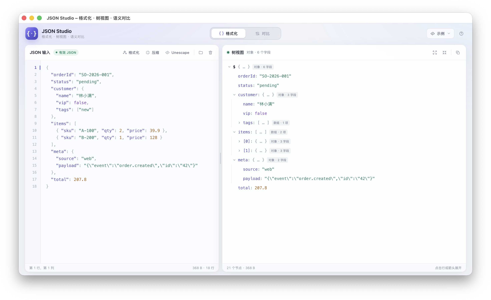
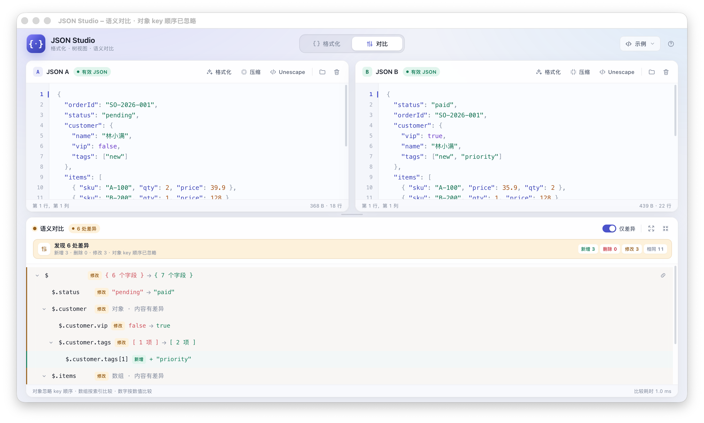

# JSON Studio

**一个原生 macOS JSON 工具箱：格式化、树视图、Unescape String，以及忽略对象 key 顺序的语义对比。完全离线运行。**

[English](README.md) | 简体中文

[](#系统要求)
[](LICENSE)
[](#开发)
[](tests/core.test.js)

JSON Studio 是一个轻量、无运行时依赖的 macOS 应用，面向每天与 JSON 打交道的开发者。它把语法高亮编辑器、可折叠树视图、双模式 Unescape String 工具，以及**在任意嵌套层级忽略对象 key 顺序**的结构化对比整合在一个窗口里。所有数据都留在本机。

| 格式化与树视图 | 语义对比 |
| --- | --- |
|  |  |

## 亮点

- **忽略 key 顺序的对比。** 顶层和任意嵌套对象重新排序都不会产生差异；真正变化的字段会被高亮。
- **清晰的树视图。** 按类型着色，支持逐层展开、复制 JSON 值、复制 JSON 路径。
- **格式化 / 压缩。** 2 空格缩进格式化，或压缩成单行；保留原始 key 顺序和数字写法。
- **Unescape String。** 还原日志、API payload 中的转义字符，或展开字符串里嵌套的 JSON。
- **原生 macOS 体验。** 原生窗口和菜单、深浅色模式、拖放导入、Finder 集成、窗口尺寸记忆。
- **默认离线。** 无遥测、无 CDN、无运行时依赖，应用不会主动发起网络请求。

## 快速开始

### 系统要求

- macOS 13 Ventura 或更高版本
- 通用二进制：同时支持 Apple Silicon 与 Intel
- 本地构建只需要 macOS Command Line Tools，不需要完整 Xcode

### 下载

1. 打开发布仓库的 **Releases** 页面。
2. 下载 `JSONStudio-<version>-macOS.zip`，必要时用同目录下的 `.sha256` 文件校验。
3. 解压后把 `JSON Studio.app` 拖入 **Applications**。

应用使用 ad-hoc 签名，未做 Apple 公证。首次启动如被 Gatekeeper 拦截，请右键 App → **打开**，或执行：

```bash
xattr -dr com.apple.quarantine "/Applications/JSON Studio.app"
```

### 从源码构建

在仓库目录中执行：

```bash
./build.sh
open "build/JSON Studio.app"
```

生成可分发的 ZIP：

```bash
./make-release.sh
# dist/JSONStudio-1.0.0-macOS.zip
```

## 功能

### 树视图与编辑器

- JSON 语法高亮、行号、当前行标记
- 解析错误显示行号和列号，并在行号栏标记错误行
- 逐节点展开/折叠，或全部展开/全部折叠
- 在行内操作中复制 JSON 值或 JSON 路径
- 通过工具栏、拖放或 Finder 的“打开方式”导入 JSON 文件

### 格式化与压缩

- **格式化**：2 空格缩进
- **压缩**：去掉多余空白，变成单行
- 保留原始对象 key 顺序和 `1e3`、`0.50` 这类数字写法
- 格式化与压缩都可用 `⌘Z` 撤销

### Unescape String

在任一编辑器中使用 `⌘⇧U` 打开。

- **整段反转义**：还原 `\"`、`\\`、`\n`、`\t`、`\uXXXX`、`\u{1F680}`、行连接符等转义序列，适合处理从日志里复制的整段转义 JSON。
- **解析嵌套 JSON**：扫描字符串值，把看起来是 JSON 的字符串替换成真正的对象或数组，适合 webhook、消息队列和双重编码的 API 字段。
- 整段反转义会保护本来就合法的 JSON，避免误伤已有结构。
- 应用前可预览输出；应用后的编辑可撤销。

### 语义对比

- 输入时实时比较
- 新增、删除、修改、相同数量的统计
- “仅差异”开关，以及全部展开/全部折叠
- 类型变化会被单独标出
- 整体新增或删除的对象可以展开查看字段细节
- 路径和值都方便阅读与复制
- 语义一致时显示明确的绿色结果提示

### 平台集成

- 原生应用菜单与快捷键
- `⌘O` 把文件导入当前编辑器
- 注册 `.json` 文档类型，支持 Finder 打开方式
- 跟随系统深浅色外观
- 支持全屏与窗口尺寸记忆

## 对比规则

| 输入 | 结果 |
| --- | --- |
| `{"a":1,"b":2}` vs `{"b":2,"a":1}` | **一致**：任意层级都忽略对象 key 顺序 |
| `[1,2]` vs `[2,1]` | **不一致**：数组按索引比较 |
| `{"n":1}` vs `{"n":1.0}` | **一致**：数字按数值比较 |
| `"\u4e2d"` vs `"中"` | **一致**：字符串按解码后的值比较 |
| 注释、尾随逗号 | **非法 JSON**：报错并定位行列 |
| 对象中的重复 key | **非法 JSON**：明确报错，而不是静默保留最后一个 |

格式、空白和 key 顺序不会影响比较结果。新增、删除、修改按叶子值计数；容器节点作为上下文显示，可展开查看细节。

## 快捷键

| 快捷键 | 功能 |
| --- | --- |
| `⌘1` | 格式化模式 |
| `⌘2` | 对比模式 |
| `⌘⇧F` | 格式化当前 JSON |
| `⌘⇧M` | 压缩当前 JSON |
| `⌘⇧U` | 打开 Unescape String |
| `⌘↵` | 立即比较 |
| `⌘O` | 打开 JSON 文件 |
| `⌘Z` / `⌘⇧Z` | 撤销 / 重做 |
| `Tab` / `⇧Tab` | 缩进 / 反缩进 |
| `Esc` | 关闭弹窗或菜单 |

## 示例

[`examples`](examples/) 目录包含小型测试数据：

- `compare-a.json` / `compare-b.json`：key 顺序不同，且包含真实字段变化
- `escaped-payload.txt`：用于测试 Unescape String 的整段转义 payload

## 项目结构

```text
json-studio/
├── .github/                   # Issue 表单、PR 模板、CI 与发布工作流
├── Native/main.m              # AppKit 外壳、菜单、文件导入、WKWebView 宿主
├── Resources/
│   ├── index.html             # 界面结构
│   ├── styles.css             # 深浅色主题
│   ├── core.js                # 解析器、序列化、diff、反转义、高亮
│   └── app.js                 # 编辑器、树视图、对比视图、交互
├── tests/
│   ├── core.test.js           # Node 单元测试与属性测试
│   └── ui-check.mjs           # 可选的无头 Chrome UI 检查
├── docs/
│   ├── ARCHITECTURE.md        # 设计与数据流
│   └── images/                # 界面截图
├── examples/                  # 手工测试数据
├── scripts/make-icon.py       # 可复现的 App 图标生成脚本
├── build.sh                   # 构建通用 .app
├── make-release.sh            # 生成已签名 ZIP
├── package.json
├── Makefile
├── CHANGELOG.md
├── CONTRIBUTING.md
├── CODE_OF_CONDUCT.md
├── SECURITY.md
├── SUPPORT.md
└── LICENSE
```

## 开发

### 环境

- macOS 13 或更高版本
- Command Line Tools：`xcode-select --install`
- Node.js 20+（测试需要）
- Google Chrome（仅可选的 UI 集成检查需要）

### 常用命令

```bash
# 核心解析、序列化、diff、反转义测试（28 项）
node --test tests/core.test.js
# 或：npm test

# 可选的 UI 集成检查（需要 Google Chrome）
node tests/ui-check.mjs

# 构建 App
./build.sh

# 生成干净、已签名的发布 ZIP
./make-release.sh
```

`build.sh` 生成 `arm64 + x86_64` 通用二进制。`make-release.sh` 会在工作区之外暂存 App，重新签名并校验，然后连同 README、许可证和截图一起打包。

技术设计与数据流见 [`docs/ARCHITECTURE.md`](docs/ARCHITECTURE.md)；提交代码前请先阅读 [`CONTRIBUTING.md`](CONTRIBUTING.md)。

## 已知限制

- 不支持 JSON5、注释和尾随逗号。
- 重复 key 会报语法错误。
- 数组始终按顺序比较，不提供“忽略数组顺序”模式。
- 对比视图不支持自定义忽略某个字段。
- 树和差异视图最多渲染 8,000 行，以避免超大 JSON 卡死界面。
- App 使用 ad-hoc 签名，未做 Apple 公证；首次启动说明见上文。
- 没有自动更新机制。
- 应用内界面目前为简体中文，欢迎贡献本地化。

## 贡献

欢迎贡献代码、文档和测试。请阅读 [CONTRIBUTING.md](CONTRIBUTING.md) 和 [Code of Conduct](CODE_OF_CONDUCT.md)。使用问题见 [SUPPORT.md](SUPPORT.md)。安全问题请遵循 [SECURITY.md](SECURITY.md)，不要在公开 issue 中披露。

发布记录见 [CHANGELOG.md](CHANGELOG.md)。

## 许可证

基于 [MIT License](LICENSE) 开源。

JSON Studio 使用 macOS AppKit、WebKit 和原生 JavaScript 构建，不包含任何第三方运行时依赖。
