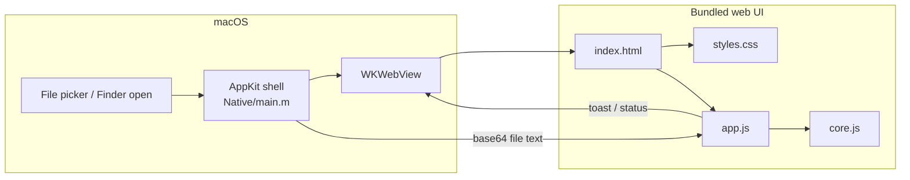

# Architecture

JSON Studio is a native macOS application with a local web UI. The native layer owns the window, menu bar, file picker, and `WKWebView`; the interface layer is plain HTML/CSS/JavaScript bundled inside the app. There is no server, build step, or third-party runtime dependency.

## Runtime layers



The native shell loads `Resources/index.html` with read access limited to the app's `Resources` directory. Imported files are read by AppKit and passed to JavaScript as a Base64-encoded payload, so the web view never needs broad filesystem access.

## Source layout

| Path | Responsibility |
| --- | --- |
| `Native/main.m` | Window, menus, keyboard equivalents, Finder integration, `WKWebView` setup, file import, JavaScript bridge |
| `Resources/index.html` | Static layout, SVG sprite, dialogs, editor cards |
| `Resources/styles.css` | Design tokens, light/dark themes, responsive layout, component styles |
| `Resources/core.js` | DOM-free JSON engine: parser, serializer, diff, unescape, tokenizer/highlighter |
| `Resources/app.js` | UI state, code editor, tree/diff rendering, modal flows, shortcuts, clipboard |
| `tests/core.test.js` | Unit tests and deterministic property tests for `core.js` |
| `tests/ui-check.mjs` | Chrome DevTools Protocol checks for the rendered UI |

## Core engine

`Resources/core.js` has no DOM dependency and is exported as `JSONCore` in the browser or as a CommonJS module in Node. This is intentional: parser and diff behavior can be tested without launching the app.

### Parser

A hand-written recursive-descent parser produces a typed tree:

- `object` with ordered `entries`
- `array` with ordered `items`
- `string`
- `number` with both the original `raw` lexeme and a numeric value
- `boolean`
- `null`

The parser preserves object key order and number spelling, rejects duplicate keys, trailing commas, comments, and control characters, and reports `JSONParseError` with an index, line, and column. It handles UTF-16 surrogate pairs and a UTF-8 BOM.

A custom parser is used instead of `JSON.parse` for two reasons:

1. `JSON.parse` gives no source positions for useful error messages.
2. JavaScript objects reorder integer-like keys, which would destroy the original ordering during format/minify.

### Serializer

`formatJSON` and `minifyJSON` walk the typed tree. Strings are escaped with `JSON.stringify`; numbers use the preserved `raw` lexeme. Object key order is stable.

### Diff

`diffJSON(a, b)` builds a tree of `added`, `removed`, `changed`, and `same` nodes:

- Objects are matched by key, independent of insertion order. A-only keys are removed, B-only keys are added, and matching keys recurse.
- Arrays are matched by index. Extra elements are added or removed.
- Numbers are compared by a canonical decimal form, so `1`, `1.0`, and `1e0` match.
- Strings are compared by decoded value, so `"\u4e2d"` matches `"中"`.
- Type changes are single `changed` nodes.
- `stats.added`, `stats.removed`, and `stats.changed` count leaf changes; `stats.same` counts unchanged leaves and empty containers.

The UI flattens only visible nodes and caps rendering at 8,000 rows.

### Unescape

`transformUnescape(text, mode)` supports two modes:

- `raw` protects input that is already a valid JSON document, decodes a whole JSON string literal when applicable, and otherwise applies a tolerant backslash unescaper (`\n`, `\t`, `\"`, `\\`, `\uXXXX`, `\u{...}`, line continuations).
- `nested` parses valid JSON, recursively expands string values that contain JSON objects/arrays (including a second unescape pass for double-encoded strings), and reserializes the result. Recursion and expansion count are bounded.

### Highlighting

`highlightJSON` is a tolerant scanner used by the editor overlay. It does not parse the document; it marks strings, keys, numbers, literals, and punctuation even while the input is incomplete or invalid. This keeps the editor responsive during typing.

## UI data flow

### Format mode

1. The editor fires an input event.
2. `app.js` debounces parsing by 130 ms.
3. `parseJSON` produces a typed tree or a `JSONParseError`.
4. The editor badge, gutter, and tree view update.
5. Tree expansion state is preserved unless the document was reset or imported.

### Compare mode

1. Both editor values are parsed.
2. If either side is invalid or empty, the diff panel shows a dedicated state.
3. Otherwise `diffJSON` runs and the diff tree is flattened according to the expansion set and “only differences” toggle.
4. The summary, banner, and rows are rendered into the diff panel.

### Unescape modal

1. The current editor text is copied into the modal input.
2. The selected mode produces a preview on every debounced input change.
3. **Apply to editor** writes the output through the editor's undoable edit path and resets the view.

## Editor implementation

The editor is a transparent `<textarea>` layered over a syntax-highlighted `<pre>`. Both use identical monospace metrics and padding. Scroll offsets are mirrored onto the highlight layer and the line-number gutter. The textarea keeps native selection, clipboard, IME, and undo behavior while the `<pre>` supplies color.

Line numbers are rendered in a separate gutter. The current line and parse-error line are highlighted without affecting the text content.

## Native shell

`Native/main.m` is a small AppKit application delegate:

- builds the window and `WKWebView`
- installs the application, File, Edit, JSON, View, Window, and Help menus
- loads `index.html` with a resource-directory read scope
- receives `appReady` and `appLog` messages from JavaScript
- reads imported files and calls `window.JSONStudio.loadBase64`
- blocks navigation away from the bundled page and opens external links in the browser
- persists window size with `NSWindow` frame autosave

The JavaScript bridge surface is intentionally small:

```text
appReady
appLog
JSONStudio.setMode
JSONStudio.formatActive
JSONStudio.minifyActive
JSONStudio.openUnescape
JSONStudio.compareNow
JSONStudio.showShortcuts
JSONStudio.loadCompareSample
JSONStudio.loadText
JSONStudio.loadBase64
```

## Security and privacy

- No network requests, telemetry, or remote assets.
- Local web content only; navigation is restricted to the bundled `index.html`.
- File access is limited to files the user explicitly opens.
- All user-controlled strings are escaped before being inserted into HTML.
- The app uses a non-persistent `WKWebsiteDataStore`.
- Release builds are ad-hoc signed. Developers distributing broadly should re-sign with Developer ID and notarize.

See [SECURITY.md](../SECURITY.md) for reporting.

## Performance

- Parsing is synchronous and debounced; the render layer is capped at 8,000 rows.
- Syntax highlighting is skipped for documents over 1.5 MB, which fall back to plain text in the editor overlay.
- Very large imported files are rejected above 30 MB by the native shell.
- The UI is optimized for typical API payloads and configuration files, not multi-hundred-megabyte data dumps.

## Testing

`tests/core.test.js` covers parser errors, formatting round-trips, numeric canonicalization, key-order-insensitive diffs, arrays, Unicode, unescape modes, highlighting, and deterministic randomized properties.

`tests/ui-check.mjs` launches headless Chrome, drives the page over the DevTools Protocol, and checks format/minify/undo, Unescape, comparison, equality, array ordering, error states, and dark-mode rendering.

## Packaging

`build.sh` compiles the universal Objective-C binary, copies local resources and the icon, and ad-hoc signs the app. `make-release.sh` copies the app to a temporary directory outside the repository, strips disallowed extended attributes, re-signs it, verifies the signature, and packages a reproducible ZIP with the README, license, and screenshots.

See [CONTRIBUTING.md](../CONTRIBUTING.md) for the release checklist.
